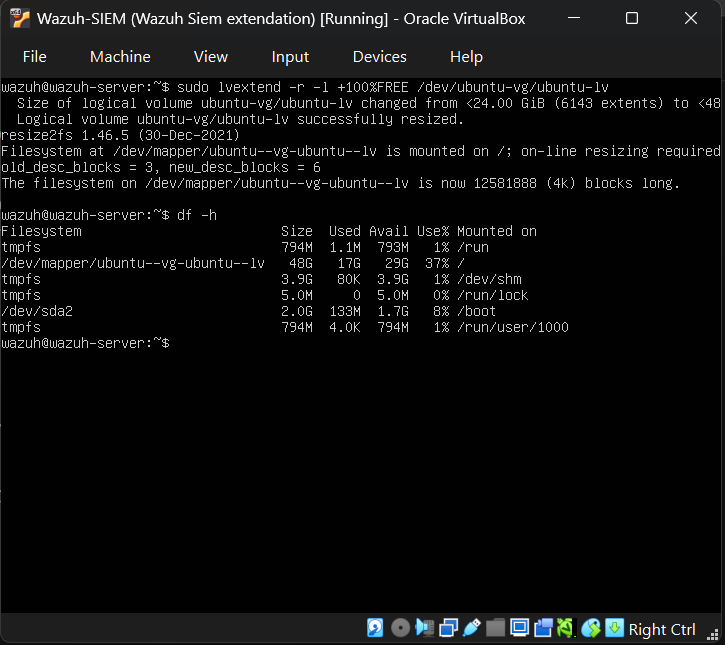
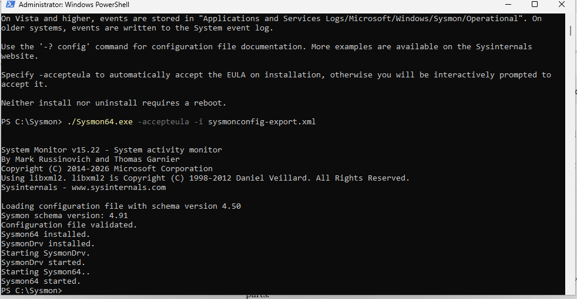
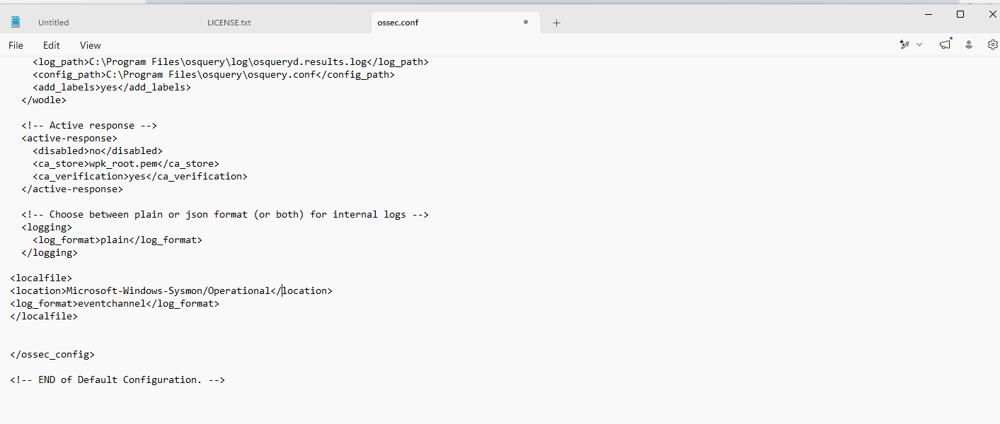
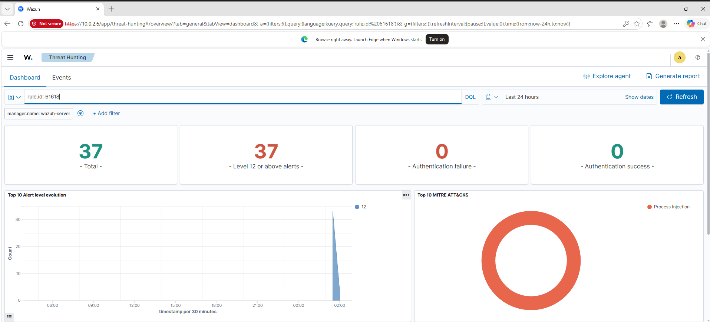
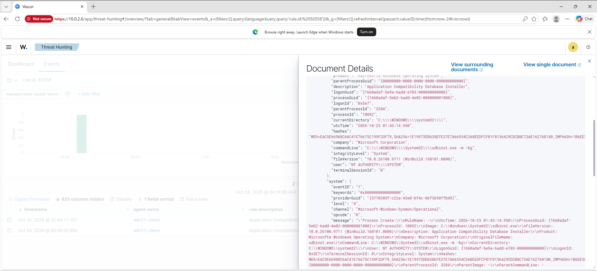
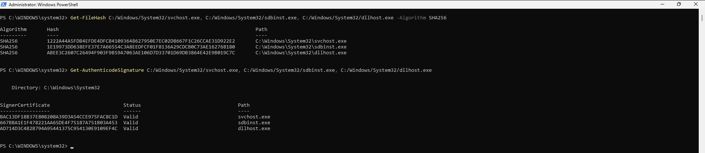
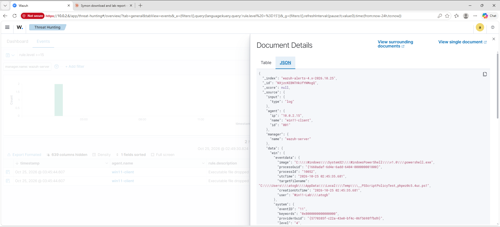
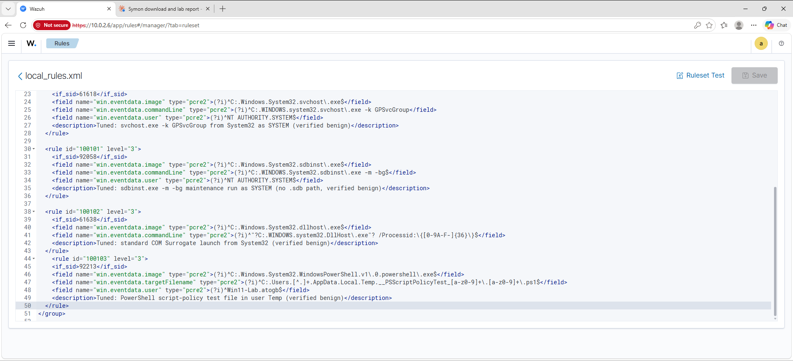

# Sysmon Deployment and First Detections in a Wazuh SIEM Home Lab

**Date:** 25-26 October 2026
**Author:** Atogbo O. Anthony
**Lab:** Wazuh 4.9 all-in-one on VirtualBox, NAT network `labnet` (10.0.2.0/24)

## Summary

I installed Sysmon on a Windows 11 endpoint and forwarded its events to Wazuh. Within hours it produced four types of high-severity alerts. I triaged each one, verified the files by hash and digital signature, concluded all four were false positives, and wrote narrow tuning rules so the noise drops without hiding real attacks.

| Item | Result |
|---|---|
| Alert types triaged | 4 (rules 61618, 61638, 92058, 92213) |
| Verdict | 4 false positives, all benign Windows behaviour |
| Files verified | svchost.exe, sdbinst.exe, dllhost.exe: SHA256 recorded, Microsoft signature Valid |
| Tuning rules written | 4 (100100 to 100103), each at level 3, not suppressed |
| 61618 alerts in 24 h before tuning | 37, all level 12 |

## Environment

| Host | IP | Role |
|---|---|---|
| wazuh-server | 10.0.2.6 | Ubuntu 22.04, Wazuh manager, indexer, dashboard |
| win11-client | 10.0.2.15 | Windows 11, Wazuh agent 4.9.2, Sysmon v15.22 |
| Kali | labnet | Attacker machine (next phase) |
| Metasploitable2 | 10.0.2.4 | Vulnerable target (next phase) |

## 1. Making room: extending the server disk

After the earlier disk-full incident, I extended the logical volume from 24 GB to 48 GB so the SIEM has room for the extra Sysmon data.

```
sudo lvextend -r -l +100%FREE /dev/ubuntu-vg/ubuntu-lv
```



*`lvextend` resized the volume and the filesystem online. `df -h` now shows 48 GB.*

## 2. Installing Sysmon

Sysmon v15.22 was installed on win11-client with the SwiftOnSecurity configuration (`sysmonconfig-export.xml`).

```
./Sysmon64.exe -accepteula -i sysmonconfig-export.xml
```



*Configuration validated, SysmonDrv and Sysmon64 installed and started.*

## 3. Sending Sysmon events to Wazuh

The Wazuh agent needs to be told to read the Sysmon event channel. I added this block to the agent's `ossec.conf`, above `</ossec_config>`:

```xml
<localfile>
  <location>Microsoft-Windows-Sysmon/Operational</location>
  <log_format>eventchannel</log_format>
</localfile>
```



*After restarting the agent, Sysmon events started arriving in Threat Hunting.*

## 4. First detections

Within hours, Sysmon produced a burst of level 12 alerts.



*37 alerts for rule 61618 in 24 hours, all level 12, mapped to MITRE T1055 Process Injection.*

Four alert types appeared:

| Rule ID | Description | Process | MITRE | Level |
|---|---|---|---|---|
| 61618 | Suspicious process | svchost.exe | T1055 | 12 |
| 61638 | Suspicious process | dllhost.exe | T1055 | 12 |
| 92058 | Application Compatibility Database launched | sdbinst.exe | T1546.011 | 12 |
| 92213 | Executable file dropped in folder commonly used by malware | powershell.exe | n/a | 15 |

A common feature in the process alerts: Sysmon recorded the parent image as `-` with a zero parent GUID, which means the parent process was not captured. That is a data gap that needs checking, but it is not proof of an attack.

## 5. Triage method

For each alert I asked six questions:

1. What rule fired, and why?
2. What actually happened? (command line, user, path)
3. Is that normal for this machine?
4. What happened around it?
5. Is the file genuine? (hash and signature)
6. What is the verdict?

### Alert 92058: sdbinst.exe



- Command line: `sdbinst.exe -m -bg`, with no `.sdb` file path. This is a Windows maintenance run, not a shim being installed.
- User: `NT AUTHORITY\SYSTEM`
- Parent: not recorded.

### Verifying the files

I checked all three processes with PowerShell (forward slashes because the VM keyboard layout differs from mine):

```
Get-FileHash C:/Windows/System32/svchost.exe, C:/Windows/System32/sdbinst.exe, C:/Windows/System32/dllhost.exe -Algorithm SHA256
Get-AuthenticodeSignature C:/Windows/System32/svchost.exe, C:/Windows/System32/sdbinst.exe, C:/Windows/System32/dllhost.exe
```



| File | SHA256 | Signature |
|---|---|---|
| svchost.exe | `1222A44A5FDB4EFDE4DFCB41093648627950E7EC02D8667F1C26CCAE31D922E2` | Valid |
| sdbinst.exe | `1E19973DD638EFE37E7A66554C3A8EEDFCF01F8136A29CDCB0C73AE162768180` | Valid |
| dllhost.exe | `ABEE3C2607C26494F903F9B59A7063AE106D7D33701D69DB3864E42E9B019C7C` | Valid |

### Alert 92213: PowerShell dropping a file in Temp

The highest-severity alert (level 15) looked scary: "Executable file dropped".



- Process: `C:\Windows\System32\WindowsPowerShell\v1.0\powershell.exe`
- File: `C:\Users\atogb\AppData\Local\Temp\__PSScriptPolicyTest_phpez0c5.4uc.ps1`
- User: my own account, at the time I was running the commands above.

PowerShell writes a `__PSScriptPolicyTest_*.ps1` file to Temp every time it starts, to test whether script execution is allowed. It then deletes it. The rule fired because a `.ps1` file appeared in Temp, which attackers also use. A second identical row was the same event stored twice, not a second file.

### Verdicts

| Alert | Command line / file | User | Verdict |
|---|---|---|---|
| 61618 svchost.exe | `svchost.exe -k GPSvcGroup` | SYSTEM | False positive: Group Policy service host |
| 61638 dllhost.exe | `DllHost.exe /Processid:{GUID}` | n/a | False positive: standard COM Surrogate |
| 92058 sdbinst.exe | `sdbinst.exe -m -bg` | SYSTEM | False positive: Windows maintenance |
| 92213 powershell.exe | `__PSScriptPolicyTest_*.ps1` in Temp | my account | False positive: PowerShell script-policy self-test |

## 6. Tuning

I wrote child rules in `/var/ossec/etc/rules/local_rules.xml` (Server management, Rules, Manage rules files). Design choices:

- **Level 3, not 0.** The event is still recorded and searchable. It just stops showing as high severity.
- **Narrow matches.** Each rule checks the full image path, the exact command line or file pattern, and the user. I did not suppress svchost.exe in general, because process hollowing in svchost is a real attacker technique. Only `-k GPSvcGroup` as SYSTEM from System32 is lowered.
- **Parent not used as a condition.** The decoded event omits the parent field when Sysmon records it as `-`.

```xml
<group name="local,sysmon,tuning,">

  <rule id="100100" level="3">
    <if_sid>61618</if_sid>
    <field name="win.eventdata.image" type="pcre2">(?i)^C:.Windows.System32.svchost\.exe$</field>
    <field name="win.eventdata.commandLine" type="pcre2">(?i)^C:.WINDOWS.system32.svchost\.exe -k GPSvcGroup</field>
    <field name="win.eventdata.user" type="pcre2">(?i)^NT AUTHORITY.SYSTEM$</field>
    <description>Tuned: svchost.exe -k GPSvcGroup from System32 as SYSTEM (verified benign)</description>
  </rule>

  <rule id="100101" level="3">
    <if_sid>92058</if_sid>
    <field name="win.eventdata.image" type="pcre2">(?i)^C:.Windows.System32.sdbinst\.exe$</field>
    <field name="win.eventdata.commandLine" type="pcre2">(?i)^C:.WINDOWS.System32.sdbinst\.exe -m -bg$</field>
    <field name="win.eventdata.user" type="pcre2">(?i)^NT AUTHORITY.SYSTEM$</field>
    <description>Tuned: sdbinst.exe -m -bg maintenance run as SYSTEM (no .sdb path, verified benign)</description>
  </rule>

  <rule id="100102" level="3">
    <if_sid>61638</if_sid>
    <field name="win.eventdata.image" type="pcre2">(?i)^C:.Windows.System32.dllhost\.exe$</field>
    <field name="win.eventdata.commandLine" type="pcre2">(?i)^"?C:.WINDOWS.system32.DllHost\.exe"? /Processid:\{[0-9A-F-]{36}\}$</field>
    <description>Tuned: standard COM Surrogate launch from System32 (verified benign)</description>
  </rule>

  <rule id="100103" level="3">
    <if_sid>92213</if_sid>
    <field name="win.eventdata.image" type="pcre2">(?i)^C:.Windows.System32.WindowsPowerShell.v1\.0.powershell\.exe$</field>
    <field name="win.eventdata.targetFilename" type="pcre2">(?i)^C:.Users.[^.]+.AppData.Local.Temp.__PSScriptPolicyTest_[a-z0-9]+\.[a-z0-9]+\.ps1$</field>
    <field name="win.eventdata.user" type="pcre2">(?i)^Win11-Lab.atogb$</field>
    <description>Tuned: PowerShell script-policy test file in user Temp (verified benign)</description>
  </rule>

</group>
```



*All four rules saved in `local_rules.xml`. Wazuh validates the XML on save, and the manager is restarted from the server console after a config check (`wazuh-analysisd -t`).*

### Do you tune every alert?

No. I tune an alert only when I have verified it as benign, when it keeps recurring and buries real alerts, and when I can describe it narrowly enough that an attacker cannot hide behind it. A one-off alert gets documented and closed instead. Every tuning rule is a small blind spot, so more rules means more risk.

### Verification status

> **To update after testing:** search `rule.id: (100100 or 100101 or 100102 or 100103)` in Threat Hunting and add a screenshot here showing new events at level 3. Old alerts stay at their original level because tuning only affects new events.

## 7. Lessons learned

- Sysmon is noisy on day one. Triage each alert with evidence instead of ignoring it or blindly suppressing it.
- A missing parent process in Sysmon is a data gap that needs checking. It is not proof of an attack.
- Tune narrowly. Matching only on the process name would also hide a real attack that abuses the same process.
- Saving a rules file does not make it active. The manager must be restarted, and `wazuh-analysisd -t` checks the rules before restarting.
- Check what is on your clipboard before saving a config file. I once pasted alert JSON into the rules file, and caught it before saving.
- Host memory matters. The lab VMs aborted under memory pressure, so shut them down cleanly and use snapshots.

## Next

Kali Nmap scan against Metasploitable2, mapped to MITRE T1046 (Network Service Discovery), with a full detection report.
