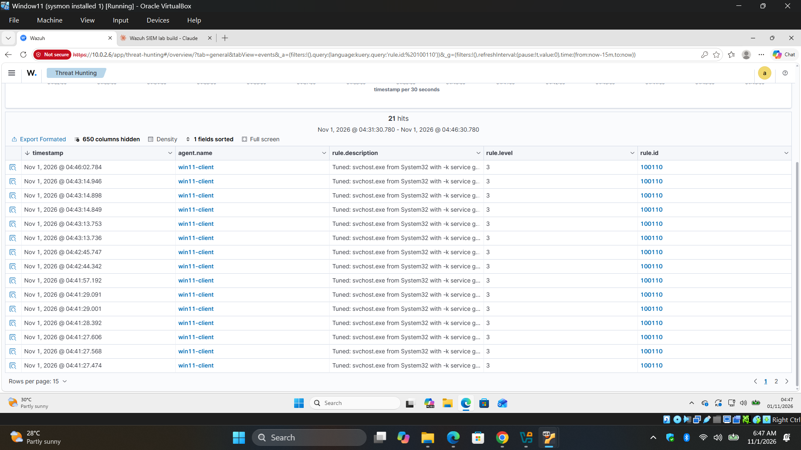
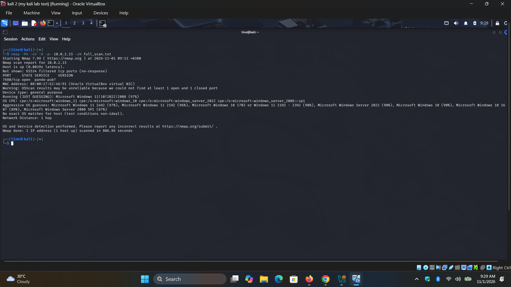
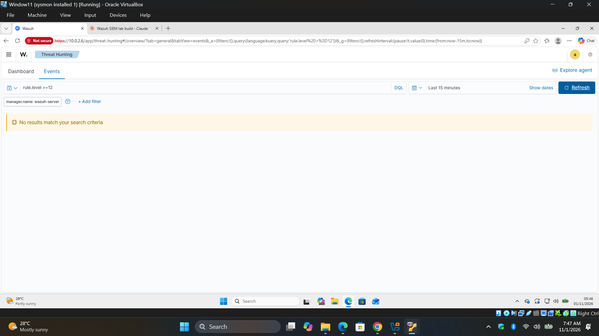
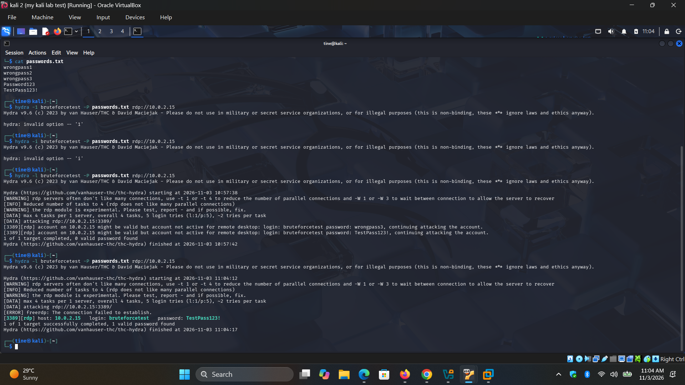
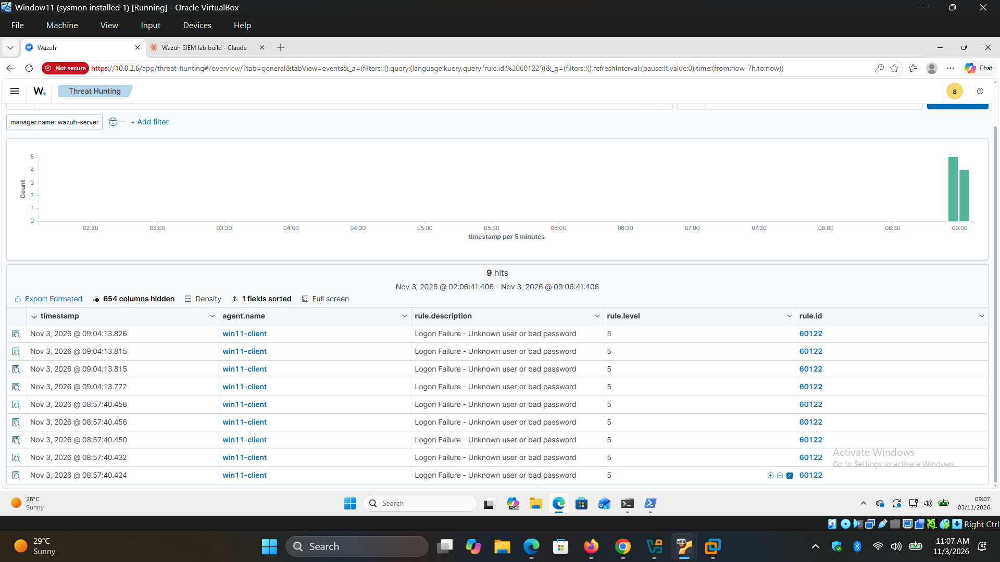
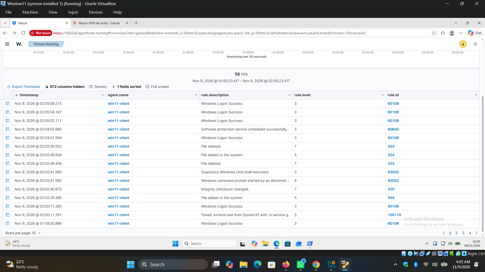

# Wazuh SIEM Home Lab — Detection Engineering Report

## Overview

This lab builds a Wazuh SIEM deployment on an isolated VirtualBox NAT network and tests it against four real attacker-relevant scenarios: noisy endpoint telemetry, network reconnaissance, credential brute-forcing, and unauthorized file tampering. The goal was to go beyond installing a SIEM and instead measure what it actually detects, document the gaps honestly, and fix what could be fixed through configuration.

**Environment (labnet, 10.0.2.0/24, NAT Network):**

| Host | Role | IP | Notes |
| --- | --- | --- | --- |
| wazuh-server | Wazuh manager (all-in-one) | 10.0.2.6 | Ubuntu Server 22.04.5, 8 GB RAM, 3 vCPU |
| win11-client | Monitored Windows endpoint | 10.0.2.15 | Windows 11 Pro 24H2, Wazuh agent v4.9.2, Sysmon v15.22 (SwiftOnSecurity config) |
| Kali | Attacker box | DHCP | Nmap, Hydra |
| Metasploitable2 | Secondary victim host | 10.0.2.4 | Used in earlier scan testing |

Sysmon feeds Windows process creation (Event ID 1) and network connection (Event ID 3) telemetry into the Wazuh agent, which forwards to the manager over an encrypted channel for correlation against both built-in and custom detection rules.

## MITRE ATT&CK Mapping

| Technique | Name | Test Performed | Result |
| --- | --- | --- | --- |
| T1046 | Network Service Discovery | Nmap SYN and full TCP connect scans from Kali against win11-client | Not detected — visibility gap identified |
| T1110 | Brute Force | Hydra RDP brute force against a throwaway local account | Detected — 9 failed-logon events correlated to one success |
| T1078 | Valid Accounts | Successful RDP logon following the brute-force attempt | Detected |
| — | Sysmon telemetry tuning | Reviewed and tuned level-12 "suspicious process" false positives | Resolved — 7 custom rules added |
| — | File Integrity Monitoring | Create / modify / rename / delete in a monitored folder | Detected — all four actions correctly logged |

## Finding 1: Sysmon False-Positive Tuning

Out of the box, SwiftOnSecurity's Sysmon config combined with Wazuh's default rule set generated a steady stream of level-12 "Suspicious Process" alerts on win11-client that were, on inspection, all benign standard Windows behavior:

| Behavior | Verified Cause |
| --- | --- |
| svchost.exe launching with `-k GPSvcGroup` | Normal Group Policy Client service start, run as SYSTEM |
| sdbinst.exe running with `-m -bg` | Routine Windows application-compatibility database maintenance, run as SYSTEM |
| dllhost.exe launched from System32 | Standard COM Surrogate process launch |
| backgroundTaskHost.exe | Native Windows UWP background task host |
| PowerShell writing to a `__PSScriptPolicyTest_*.ps1` file in Temp | PowerShell's own internal script-execution-policy self-test, not user activity |
| Windows Defender applying an `AM_Delta_Patch` | Routine signature update |

Each was verified against its parent process, command line, and execution context before being tuned — none were tuned blind. Seven custom rules (IDs 100100–100116) were added to `local_rules.xml` on the Wazuh manager, each scoped tightly to the exact binary, command-line pattern, and user context observed, down-leveling these specific patterns to level 3 (informational) rather than suppressing the parent rule outright. This preserves detection if the same binary is ever invoked with a different, more suspicious command line.

**Proof — Wazuh dashboard, `rule.id:100110` after tuning:**



## Finding 2: Nmap Scan Visibility Gap (T1046)

The most significant finding of this lab: **a fully tuned Sysmon + Wazuh HIDS deployment generated zero alerts for an Nmap port scan**, and the cause is structural rather than a missing rule.

**Test setup:** Sysmon Event ID 3 (network connection) logging was enabled and forwarded to Wazuh. Two custom correlation rules were added — a baseline rule matching any Event ID 3 connection, and a frequency-based rule (10+ connections to distinct destination ports from one source within 60 seconds) mapped to T1046.

**Test runs:**

| Scan | Command | Ports Found | Wazuh Alerts |
| --- | --- | --- | --- |
| SYN scan | `nmap -Pn -sV -O -p- 10.0.2.15` | 1 open (7680/tcp, Delivery Optimization) | 0 |
| TCP connect scan | `nmap -Pn -sT -p- 10.0.2.15` | 1 open | 0 |

Both scan techniques produced identical results: zero Event ID 3 hits tied to the scan, and zero correlation-rule triggers.

**Root cause:** Sysmon Event ID 3 only logs a connection once it reaches the socket/process layer of the OS — i.e., once a local process actually calls `connect()`. Windows Firewall evaluates and silently drops inbound traffic to filtered ports *before* that traffic ever reaches a listening process. Since nearly all of win11-client's ports were firewall-filtered rather than open, the scan traffic never generated a `connect()` event for Sysmon to see, regardless of whether Nmap used a stealth SYN scan or a full TCP handshake.

This means Sysmon-based endpoint telemetry alone is **blind to port scanning against a properly firewalled host** — not because of a missing Wazuh rule, but because the firewall prevents the very event the detection depends on from ever being generated. Closing this gap requires a different data source: network-level visibility (a NIDS like Suricata/Zeek, SPAN/mirror port capture, or Windows Firewall's own connection-security audit logging) rather than process-level telemetry.

**Proof — the scan and the dashboard's silence:**





## Finding 3: RDP Brute-Force Detection (T1110 / T1078)

To validate Wazuh's authentication-monitoring path, Remote Desktop was enabled on win11-client and a dedicated, low-privilege throwaway account (`bruteforcetest`, added only to the local Remote Desktop Users group — no admin rights) was created specifically for this test, isolated from any production credentials.

**Attack:** Hydra, run from Kali, attempted an RDP password brute force against the throwaway account using a wordlist.

**Result:** Wazuh correctly detected and correlated the full attack chain:

| Stage | Rule | Count |
| --- | --- | --- |
| Failed logon attempts | 60122 – Logon Failure | 9 |
| Successful logon | 60106 – Windows Logon Success | 1 (final attempt) |

The sequence of repeated failures immediately followed by a success against the same account is the textbook signature of a successful brute-force compromise, mapping cleanly to **T1110 (Brute Force)** for the attack itself and **T1078 (Valid Accounts)** for the account's subsequent use. Unlike the Nmap scan, this test showed Wazuh's authentication telemetry path working exactly as expected — Windows Security event logs are generated and forwarded regardless of any firewall-layer filtering, since the connection itself succeeds before authentication is attempted.

**Proof — the attack and the detection:**





## Finding 4: File Integrity Monitoring (FIM)

A mock "sensitive documents" folder (`C:\SensitiveDocs`) was created on win11-client and added to real-time FIM monitoring via the agent's own `ossec.conf` (FIM/syscheck configuration lives on the agent, not the manager):

```xml
<directories realtime="yes" report_changes="yes">C:\SensitiveDocs</directories>
```

Two configuration issues surfaced and were corrected during setup — worth noting since both are easy mistakes with this exact symptom:

1. A block of custom detection rules had been mistakenly pasted into the **agent's** `ossec.conf` rather than `local_rules.xml` on the **manager**. Rule `<group>` definitions are manager-side only; placed in an agent config they produce a hard config-parse failure (`Invalid element in the configuration: 'group'`) and the agent won't start.
2. A missing colon in the path (`C\SensitiveDocs` instead of `C:\SensitiveDocs`) caused Wazuh to silently resolve the directory as a relative path inside its own install folder rather than the intended `C:\SensitiveDocs` — no error, just silent monitoring of the wrong location.

**Test:** create, modify, rename, and delete operations were performed against files inside the monitored folder.

| Action | Rule Triggered | Description |
| --- | --- | --- |
| File created | 554 | File added to the system |
| File modified | 550 | Integrity checksum changed |
| File renamed | 553 + 554 | File deleted + File added (rename registers as both) |
| File deleted | 553 | File deleted |

All four actions were correctly and immediately captured once the configuration was corrected, confirming real-time FIM coverage for unauthorized file tampering — relevant to data-integrity and insider-threat scenarios, as well as post-exploitation file staging.

**Proof — Wazuh dashboard, FIM events for `C:\SensitiveDocs`:**



## Key Takeaways

- **A SIEM's coverage is only as good as the telemetry feeding it.** Tuning rules cannot create visibility that the underlying data source never produces — the Nmap gap exists at the OS/firewall layer, below Sysmon, and no amount of Wazuh rule-writing closes it.
- **False-positive tuning requires verification, not suppression.** Every tuned alert in this lab was confirmed benign by checking its parent process, command line, and execution context first; rules were scoped narrowly rather than silencing entire rule IDs.
- **Authentication telemetry and endpoint process telemetry have different blind spots.** The RDP brute-force test succeeded cleanly because a completed TCP handshake and a Windows logon event don't depend on firewall port-filtering the way a port scan does — different attack techniques stress different parts of the detection stack.
- **Config-as-code mistakes in Wazuh fail in two different ways.** A structurally invalid block (rules pasted into an agent config) fails loudly and stops the service. A logically wrong but syntactically valid value (a missing colon in a path) fails silently and just monitors the wrong thing — the second kind is more dangerous because nothing alerts you to it.

## Next Steps

- Close the Nmap visibility gap with network-level detection (Suricata or Zeek on a SPAN/mirror port, or Windows Firewall connection-security audit logging)
- Extend FIM to additional high-value paths (startup folders, scheduled tasks directory)
- Add active-response automation (e.g., auto-disable an account after repeated brute-force failures)
- Build a short Wazuh dashboard walkthrough as a companion piece, aimed at someone new to reading SIEM alerts


